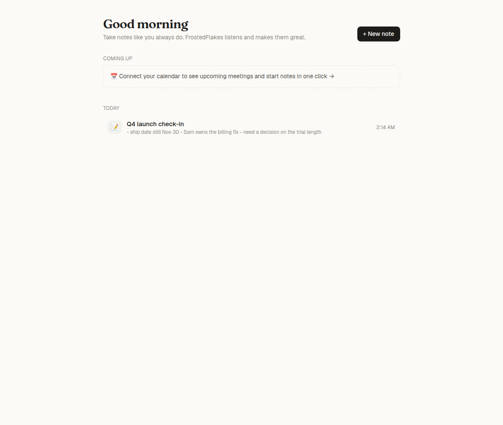
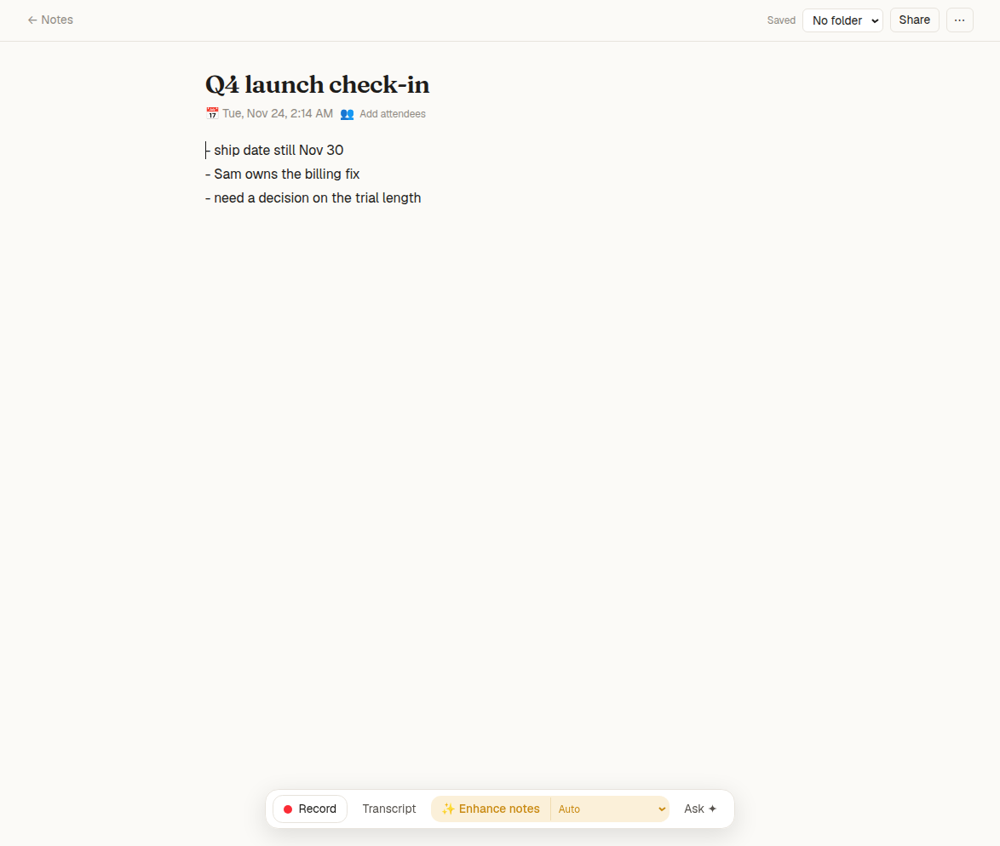
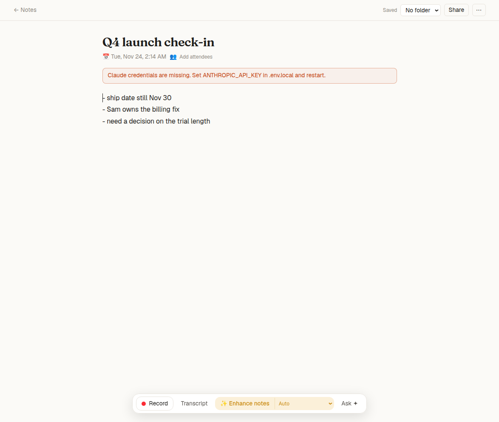
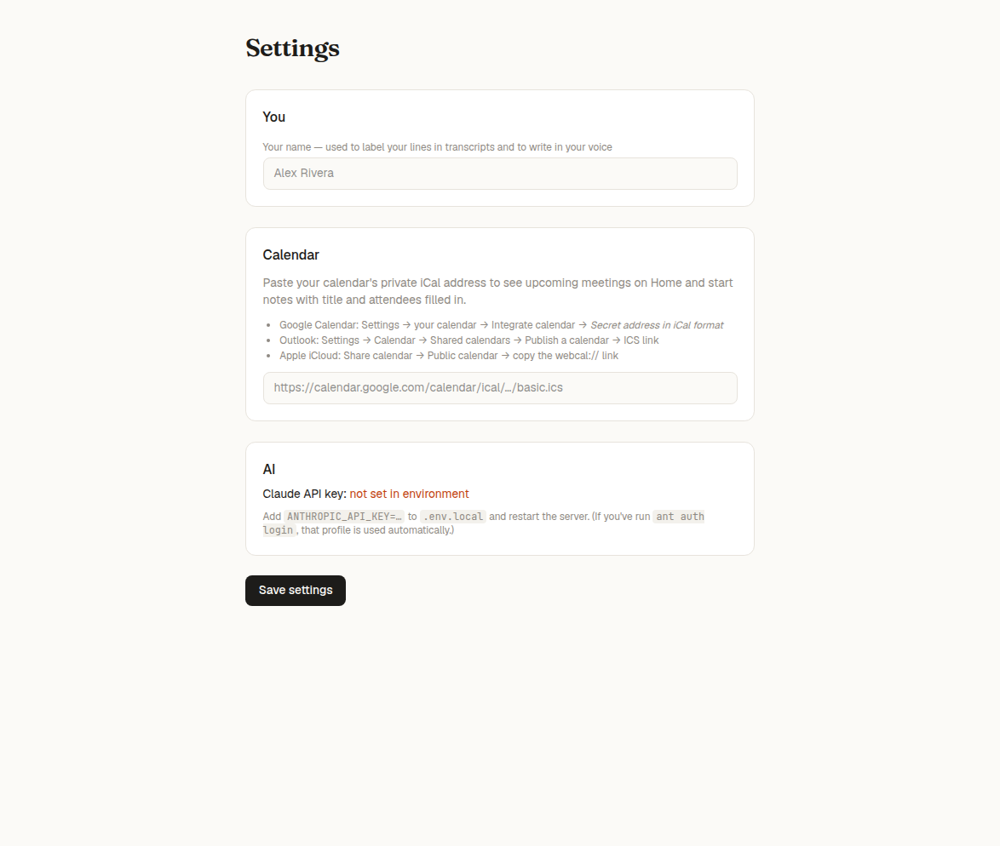

# FrostedFlakes

[](https://github.com/aneesh-pradhan/frostedflakes/actions/workflows/ci.yml)

FrostedFlakes is a local notepad for people in back-to-back meetings. You jot rough notes during the call, and the app can transcribe from your own microphone so no bot joins. When you add an Anthropic API key, **Enhance** turns those notes and the transcript into structured notes, and **Ask** drafts follow-ups from them.

Without a key, the notepad, transcription, folders, search, calendar, templates, and sharing still work. Enhance and Ask are the only features that call Claude.

## Screenshots

Captured from a local run with no API key. The note was typed in the app.

Home, after saving a note:



The note itself:



Enhance, with no API key configured. The app keeps the notes and shows this error:



Settings confirms the key is unset:



## Prerequisites

These steps were verified with:

| Tool | Version |
| --- | --- |
| Git | 2.43.0 |
| Node.js | 22.23.4 |
| npm | 10.9.9 |

CI installs, lints, and builds with Node.js 22.23.4.

Live transcription uses the Web Speech API. It works in Google Chrome (verified in 157.0.8103.50), Edge, and Safari. Firefox can still take notes, paste a transcript, and use every other feature.

Nothing else is required. Notes are stored in `data/db.json` on disk. That directory is gitignored.

## Setup and run

```bash
git clone https://github.com/aneesh-pradhan/frostedflakes.git
cd frostedflakes
npm ci
npm run dev
```

Open http://localhost:3000.

`npm ci` installs the lockfile. `npm run dev` starts Next.js on port 3000.

## Run without an API key

Skip `.env.local`. Do not copy `.env.example` unless you are about to replace the placeholders: a non-empty `ANTHROPIC_API_KEY` makes Settings report that a key is configured.

With no env file:

- **New note**, typing, and autosave work. The editor shows **Saved** after a pause.
- **Record** transcribes in Chrome, Edge, or Safari. You can also paste a transcript.
- Folders, search, templates, calendar (paste an iCal URL in Settings), share links, and Markdown export work.
- **Enhance notes** returns: `Claude credentials are missing. Set ANTHROPIC_API_KEY in .env.local and restart.`
- **Ask** streams the same message, prefixed with a warning sign.

## Run with Claude

```bash
cp .env.example .env.local
```

Edit `.env.local`:

1. Replace `sk-ant-api03-your-key-here` with a key from https://console.anthropic.com/.
2. Clear `ANTHROPIC_AUTH_TOKEN` and `ANTHROPIC_PROFILE` unless you mean to use those instead of the API key.
3. Restart `npm run dev`.

Settings then shows the Claude API key as detected. **Enhance notes** and **Ask** call the model in `FROSTEDFLAKES_MODEL` (`claude-opus-5-5` unless you change it).

`.env`, `.env.local`, and every other env file except `.env.example` are gitignored. Do not commit a real key.

## Scripts

| Command | What it does |
| --- | --- |
| `npm run dev` | Development server at http://localhost:3000 |
| `npm run lint` | ESLint (`next/core-web-vitals` and `next/typescript`) |
| `npm run build` | Production build |
| `npm start` | Serve the production build |

## Features

| | |
| --- | --- |
| **Bot-free live transcription** | Hit **Record** and FrostedFlakes listens through your mic in the browser (Web Speech API), with a live level meter and timer. Pause and resume whenever you like. You can also paste a transcript. |
| **Notepad first** | A plain editor. Type short fragments during the call and let Enhance fill in the rest when a key is configured. |
| **Enhance notes** | Claude merges your notes with the transcript into a summary, sections, and action items with owners. Your points show in black and AI additions in gray. Click any line to edit it. |
| **Templates** | Built in: Auto, 1:1, Stand-up, Customer Discovery, Sales Call (BANT), Candidate Interview, Brainstorm. You can add your own sections and instructions. Switching template regenerates the notes. |
| **Ask (per meeting)** | Chat with one meeting: "Write a follow-up email", "What did I miss?", "Draft a Slack recap". |
| **Ask FrostedFlakes** | Chat across every meeting, or one folder: "What did I commit to this week?", "Prep me for my next call". |
| **Calendar** | Paste a private iCal URL (Google, Outlook, iCloud) to see upcoming meetings. One click starts a note with the title and attendees filled in. Recurring events are supported. |
| **Folders and search** | Organize notes into folders and search notes, enhanced notes, and transcripts. |
| **Sharing** | Create a public read-only link, copy the notes as Markdown, or download a `.md` file. |
| **Speaker labels** | Lines are marked Me/Them. Click a label to switch it. |

## How it works

- `src/lib/ai.ts` calls Claude (`claude-opus-5-5` by default, override with `FROSTEDFLAKES_MODEL`):
  - **Enhance** uses a JSON schema so each bullet carries `source: "user"` or `"ai"`.
  - **Chat** streams plain text. Meeting material sits in a cached system block.
- `src/components/useTranscriber.ts` does browser speech-to-text and drives the level meter.
- `src/lib/ics.ts` parses iCal, including time zones and daily or weekly recurrence, with no extra dependency.
- `src/lib/db.ts` stores everything in a JSON file. Writes are serialized. `FROSTEDFLAKES_DATA_DIR` changes the directory (default `./data`).

## Known MVP limitations

- Transcription uses the microphone only. On a call with headphones, other people's voices are not captured.
- Speaker labels are Me/Them, set by hand.
- It is single-user and local, with no auth. A share link is public to anyone who has the URL and can reach your server.

## License

MIT. Copyright (c) 2026 Aneesh Pradhan. See [LICENSE](LICENSE).
